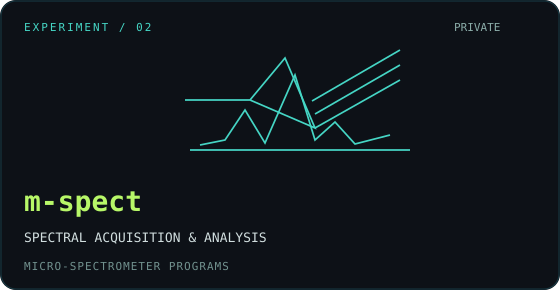
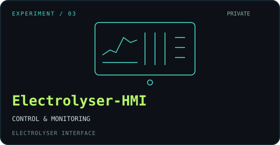
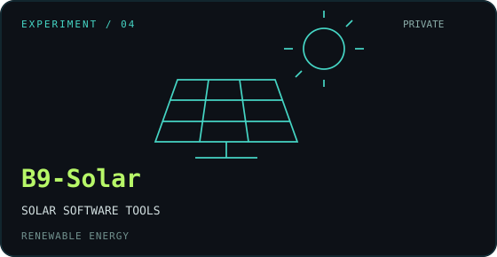
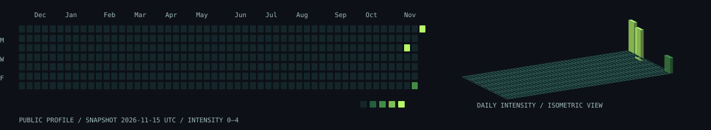

<p align="center">
  
</p>

### `01 / WHOAMI`

```python
class ZUOLEM:
    interests = (
        "Scientific computing",
        "Engineering R&D",
        "Data analytics",
        "Computer vision",
        "Embedded systems and IoT",
        "Signal processing",
        "Automation",
    )
    philosophy = "Build. Measure. Analyse. Iterate."
```

### `02 / TOOLBOX`

<p>
  
  
  
  
  
  
  
  
</p>

### `03 / SELECTED EXPERIMENTS`

Private projects · a view into the work, with source code kept private.

<p align="center">
  
  
  
  
</p>

<details>
<summary>Project notes / text view</summary>

- **ZuoStation** — ESP32-based weather station for environmental monitoring.
- **m-spect** — Micro-spectrometer programs for spectral acquisition and analysis.
- **Electrolyser-HMI** — Control and monitoring interface for an electrolyser system.
- **B9-Solar** — Solar-related software tools.

All four repositories are private.

</details>

### `04 / TECHNICAL DOMAINS`

| Observe & understand | Build & control |
| :--- | :--- |
| Scientific instrumentation | Engineering research |
| Data analytics and visualisation | Embedded hardware and automation |
| Computer vision and image processing | Signal processing |

### `05 / CONTRIBUTION SIGNAL`

<p align="center">
  
</p>

[View the live contribution calendar](https://github.com/Zuolem?tab=overview) · Public profile data only; no private repository details.

---

`ZUOLEM//` · **Build. Measure. Analyse. Iterate.**
