<picture>
  <source media="(max-width: 600px)" srcset="assets/hero-mobile.svg" />
  
</picture>

<picture>
  <source media="(max-width: 600px)" srcset="assets/whoami-mobile.svg" />
  
</picture>

### ⚒ Toolbox & research focus

<picture>
  <source media="(max-width: 600px)" srcset="assets/toolbox-mobile.svg" />
  
</picture>

### ◇ Projects

<picture>
  <source media="(max-width: 600px)" srcset="assets/projects-mobile.svg" />
  
</picture>

Project notes · all source repositories are private

- **ZuoStation** — ESP32-based weather station for environmental monitoring.
- **m-spect** — Micro-spectrometer programs for spectral acquisition and analysis.
- **Electrolyser-HMI** — Control and monitoring interface for an electrolyser system.
- **B9-Solar** — Solar-related software tools.

The illustrations do not represent measured project results. Source code is private.

### ▥ Activity

<picture>
  <source media="(max-width: 600px)" srcset="assets/activity-mobile.svg" />
  
</picture>

[Live contribution calendar](https://github.com/Zuolem?tab=overview) · Public profile data only.

ZUOLEM// · Build. Measure. Analyse. Iterate.

